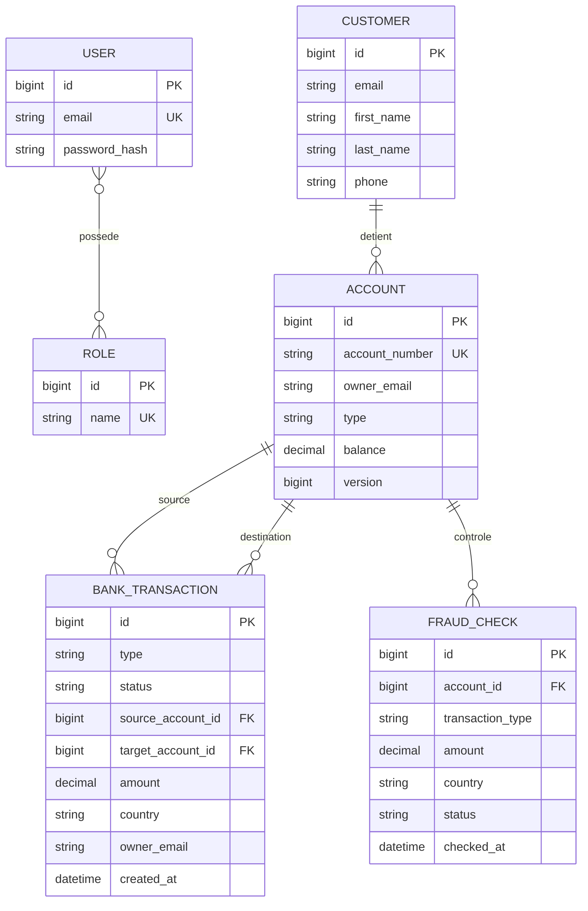

# Modèle de données

## MCD

Les liens entre services sont des références logiques : les bases H2 restent isolées et ne portent pas de contraintes FK interservices.

## MLD SQL (account-service et transaction-service)

Le script exécutable est [`schema.sql`](schema.sql). Les entités JPA créent ces tables automatiquement dans les bases H2 séparées.